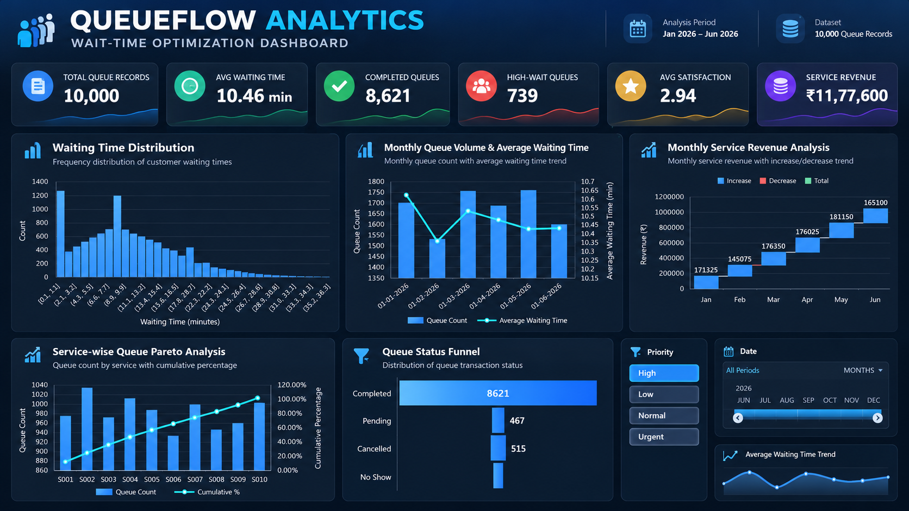

# QueueFlow Analytics – Wait-Time Optimization

An Advanced Excel-based Data Analytics project designed to analyze queue performance, identify waiting-time patterns, evaluate service efficiency, and support data-driven operational decisions.

## 📊 Project Overview

**QueueFlow Analytics** transforms raw queue transaction data into meaningful business insights using Microsoft Excel and its advanced analytics capabilities.

The project uses a dataset of **10,000 queue transaction records** covering customer details, services, locations, counters, waiting times, service times, payment information, and customer satisfaction.

It follows an end-to-end analytics workflow, from data cleaning and formula-based analysis to forecasting, Power Query transformations, Power Pivot data modelling, DAX calculations, and interactive dashboard development.

## 🎯 Project Objectives

- Clean and transform raw queue transaction data.
- Identify waiting-time patterns and service bottlenecks.
- Analyze queue performance across services, locations, and customer categories.
- Apply advanced Excel formulas for data analysis.
- Perform forecasting and trend analysis.
- Use What-If Analysis for operational and financial decisions.
- Build a relational data model using Power Pivot.
- Create DAX measures and an interactive KPI dashboard.

## 📈 Dashboard Preview



## 📌 Key Performance Indicators

| KPI | Dashboard Result |
|---|---:|
| Total Queue Records | 10,000 |
| Average Waiting Time | 10.46 minutes |
| Completed Queue Count | 8,621 |
| High-Wait Queue Count | 739 |
| Average Satisfaction | 2.94 |
| Total Service Revenue | ₹11,77,600 |

## 🧩 Project Modules

### Module 1 – Data Cleaning & Formula Analysis

- Raw data inspection and validation
- Missing values and duplicate identification
- Data standardization and logical classification
- Dynamic array analysis
- Lookup and reference operations
- Service-wise, customer-wise, priority-wise, and location-wise analysis

**Excel Functions:** `IF`, `AND`, `OR`, `IFERROR`, `COUNTIF`, `AVERAGEIF`, `SUMPRODUCT`, `UNIQUE`, `FILTER`, `SORT`, `SORTBY`, `INDEX`, `MATCH`, `XLOOKUP`

### Module 2 – Analytics & Forecasting

- Daily and monthly queue analysis
- Waiting-time trend analysis
- Forecasting future waiting time
- Date and working-day analysis
- Financial decision modelling
- Break-even analysis

**Excel Functions:** `FORECAST`, `TREND`, `RSQ`, `LINEST`, `EOMONTH`, `WORKDAY`, `NETWORKDAYS`, `DATEDIF`, `NPV`, `IRR`, `PMT`

**What-If Technique:** Goal Seek

### Module 3 – Power Query & What-If Analysis

- Data Validation
- Conditional Formatting
- Error Handling
- Formula Auditing
- Power Query data transformation
- Scenario Manager
- Goal Seek
- Data Tables

### Module 4 – Power Pivot, DAX & Dashboard

- Excel Data Model creation
- Relationships between queue and service master tables
- DAX measures and calculated columns
- KPI creation
- PivotTables and PivotCharts
- Interactive Slicers and Timeline
- Dashboard-based performance monitoring

**DAX Functions:** `CALCULATE`, `COUNTROWS`, `AVERAGEX`, `SUMX`, `FILTER`, `RELATED`, `DIVIDE`, `TOTALYTD`, `SAMEPERIODLASTYEAR`

## 📊 Dashboard Visualizations

The interactive dashboard includes:

- Waiting Time Distribution – Histogram
- Monthly Queue Volume & Average Waiting Time – Combo Chart
- Monthly Service Revenue Analysis – Waterfall Chart
- Service-wise Queue Pareto Analysis
- Queue Status Funnel
- Priority Slicer
- Date Timeline
- Sparkline Trend

## 🛠️ Tools & Technologies

| Tool | Purpose |
|---|---|
| Microsoft Excel | Data analysis and dashboard development |
| Advanced Excel | Formula-based analysis |
| Power Query | Data cleaning and transformation |
| Power Pivot | Data modelling and relationships |
| DAX | Measures and KPI calculations |
| PivotTables | Data summarization |
| PivotCharts | Data visualization |
| What-If Analysis | Financial and operational modelling |

## 🔄 Project Workflow

```text
Raw Queue Dataset
       ↓
Data Inspection & Cleaning
       ↓
Advanced Excel Formula Analysis
       ↓
Analytics & Forecasting
       ↓
Power Query Transformation
       ↓
What-If Analysis
       ↓
Power Pivot & DAX
       ↓
Interactive Dashboard
       ↓
Insights & Decision Support
```

## 📁 Project Files

| File | Description |
|---|---|
| `QueueFlow_Analytics.xlsx` | Complete Excel workbook with dataset, analysis, and dashboard |
| `Project_Report.pdf` | Detailed academic project documentation |
| `screenshots/dashboard.png` | Dashboard preview image |

## 🚀 How to Explore the Project

1. Clone or download this repository.
2. Open `QueueFlow_Analytics.xlsx` using Microsoft Excel.
3. Navigate through the raw data, cleaned data, and module analysis sheets.
4. Open the **Dashboard** worksheet.
5. Use the available slicers and timeline to explore queue performance.
6. Refer to `Project_Report.pdf` for detailed methodology, formulas, and findings.

> **Note:** For the best experience, use Microsoft Excel with Power Pivot and the required Data Model features enabled.

## 📚 Key Findings

Based on the project analysis:

- The dataset contains 10,000 queue transactions.
- Overall average waiting time is approximately 10.46 minutes.
- 8,621 transactions have a Completed status.
- Average customer satisfaction is approximately 2.94.
- Total service revenue is ₹11,77,600.
- Forecasting techniques were applied to estimate future waiting time.
- Financial modelling was used to evaluate the feasibility of an additional service counter.

## 🎓 Academic Project

**Project Title:** QueueFlow Analytics – Wait-Time Optimization

**Subject:** Data Analytics with Advanced Excel

**Course:** M.Sc. Data Analytics – Part I

**Academic Year:** 2026–27

**Institution:** Pillai College of Arts, Commerce & Science

## 👨‍💻 Author

**Moin Shaikh**

M.Sc. Data Analytics Student | Aspiring Data Analyst

- GitHub: [@moinshaikh6249](https://github.com/moinshaikh6249)
- Portfolio: [moin-shaikh-portfolio.vercel.app](https://moin-shaikh-portfolio.vercel.app/)

---

⭐ If you find this project interesting, consider giving this repository a star!